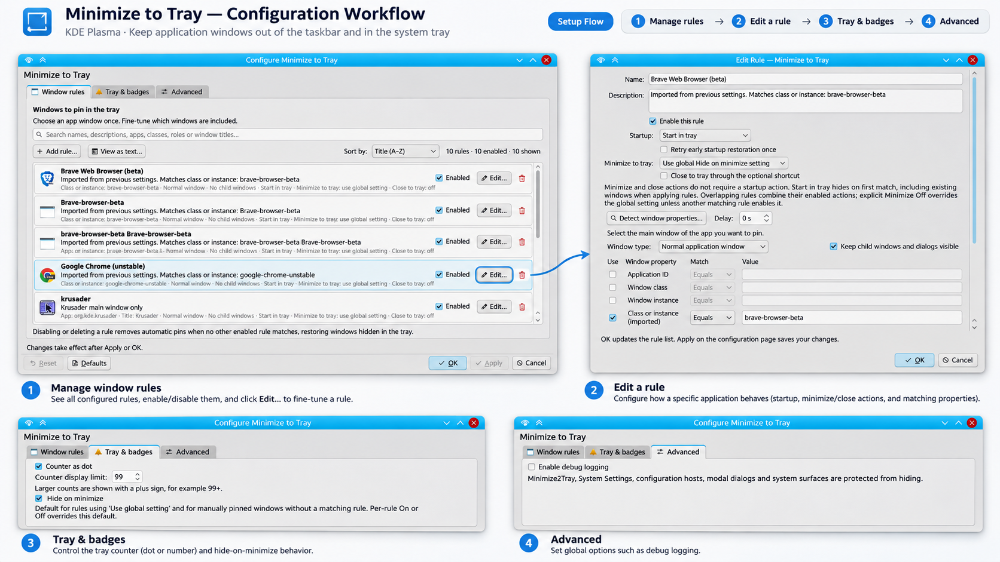

# KWin Minimize2Tray — PhobosK fork

**This is the [PhobosK fork](https://github.com/PhobosK/kwin-minimize2tray) of [KWin Minimize2Tray](https://github.com/luisbocanegra/kwin-minimize2tray), originally created by [Luis Bocanegra](https://github.com/luisbocanegra).**

This fork builds on the original work with reliability fixes, easier configuration and selected KDocker-like features, while preserving Wayland support and existing X11 compatibility.

**This is work in progress, don't expect feature parity with other implementations right away**

Hide windows to the system tray, similar to [KDocker](https://github.com/user-none/KDocker) but in the form of a KWin Script that works on KDE Plasma 6.0+ Wayland.




> [!IMPORTANT]
> Some Chromium/Electron applications need native Wayland mode for reliable hiding. Check their window type in KWin Debug Console and see the [Wayland notes](https://wiki.archlinux.org/title/Wayland#GUI_libraries).

### A note about AI-assisted development

This fork is largely developed with AI assistance ("vibe coding"), with features directed, reviewed, and tested by me. I'm a long-time KDE/Qt and open-source developer who simply doesn't have as much free time for coding as I used to.

You can read more about why I chose this approach in [AI_DISCLOSURE.md](AI_DISCLOSURE.md).

## Features

- Minimize windows to tray and restore them without changing monitor, geometry, desktop or activity memberships. Showing a window switches to its assigned desktop/activity.
- Searchable per-window rules, sorted by title or creation time, with KWin detection, matching previews and configuration backup/restore. Apply/OK updates running windows immediately.
- Independent startup and minimize actions, plus close-to-tray through an optional shortcut. Child windows, modal dialogs and system/configuration windows are protected by default.
- Desktop-file icons, application-provided [Unity LauncherAPI](https://wiki.ubuntu.com/Unity/LauncherAPI) counters/progress/urgency, and per-window attention. Counts are shared between an app's windows; notifications are not unread counters.
- About and configuration access from tray menus. Plasma currently does not display the action tooltips.
- Wayland support and existing X11 compatibility; X11 support was [reported upstream](https://github.com/luisbocanegra/kwin-minimize2tray/issues/25).

## Installation

Install Python 3.12+, CMake 3.19+, a C++20 compiler, ECM, KDE’s `kcmshell6` configuration host, Qt 6.6+ development files (DBus, Gui, Qml, Widgets) KDE DocTools 6 (`meinproc6`), KHelpCenter for the installed handbook, and KF6 development files (Config, CoreAddons, Service, StatusNotifierItem, KCMUtils, XmlGui). The RPM spec lists openSUSE dependencies. Optional **Quit on logout** support also needs Linux 6.13+ headers and the KWin 6.8+ SDK with its Wayland development dependencies; the isolated adapter uses the SDK’s compiler requirements. Rebuild after KWin updates. Without that SDK, other features still build normally. Disable the adapter with `-DBUILD_SESSION_TERMINATION=OFF`.

```sh
git clone https://github.com/PhobosK/kwin-minimize2tray.git
cd kwin-minimize2tray
./install.sh
```

Run as a regular user. The installer builds the fork's latest stable `X.Y.Z`/`vX.Y.Z` tag and installs under `/usr`, using sudo only for final copies. It leaves the checkout and existing `build/` alone. Network failures stop installation.

Use `./install.sh --local` for unpublished checkout changes, or `./install.sh --version 2.4.1` for a specific release. Both installers offer `--help` for source selection, commit pinning, prefixes, staged installation and offline archives.

### Immutable/user installation

Run `./install-immutable.sh` to install under `~/.local` without sudo; add `--local` for checkout changes. Put these lines in `~/.config/plasma-workspace/env/path.sh`, creating its parent directories as needed, then log out and back in:

```sh
export QML_IMPORT_PATH="$HOME/.local/lib/qml:$QML_IMPORT_PATH"
export QT_PLUGIN_PATH="$HOME/.local/lib/plugins:$QT_PLUGIN_PATH"
```

For a custom prefix, use the paths printed by the installer. A user installation can shadow a system copy; remove unwanted copies yourself. After updating native plugins, start a new Plasma session.

### openSUSE Tumbleweed RPM

The standalone spec builds this fork only. It defaults to tag `v2.4.1`; `release_version` sets both the RPM and application version. It downloads the selected archive if missing from RPM's `SOURCES` directory.

```sh
rpmbuild -ba distro/rpm/kwin6-script-minimize2tray.spec
```

Select another tagged release:

```sh
rpmbuild -ba --define 'release_version 0.4.0' distro/rpm/kwin6-script-minimize2tray.spec
```

Or select a full commit SHA with an explicit application version:

```sh
rpmbuild -ba --define 'release_version 2.4.1' --define 'commit FULL_SHA' distro/rpm/kwin6-script-minimize2tray.spec
```

The tag format is `vX.Y.Z`. Selected sources must contain this fork's native configuration module and current CMake version option.

### Debian and Ubuntu packages

The version in `distro/debian/changelog` selects the fork's `vX.Y.Z` tag and sets the package/application versions. Preparation needs Python 3.12+ and `dpkg-dev`:

```sh
./distro/debian/prepare.py /tmp/minimize2tray-deb
```

For a specific commit, add `--commit FULL_SHA`. `--archive /path/to/source.tar.gz` uses the matching GitHub archive offline. The output directory must be new. Use a new upstream changelog version when changing orig-archive contents.

In the prepared source directory, install build dependencies and build:

```sh
sudo apt-get build-dep ./
dpkg-buildpackage -us -uc
```

This targets Debian 13 and Ubuntu 26.10 with Plasma 6 development packages (Ubuntu needs Universe). Source selection and its checksum are recorded in the prepared package; the build performs no tag lookup or download. No container is required.

### Arch Linux and Gentoo

The release workflow builds an Arch Linux package and publishes Arch source recipes plus a Gentoo overlay. All use the same published source archive; checksums are generated from that archive rather than skipped. Prepare recipes from a published release, or add `--archive /path/to/source.tar.gz` for offline use (`--commit FULL_SHA` selects a commit archive):

```sh
python3 distro/prepare.py arch /tmp/minimize2tray-arch
python3 distro/prepare.py gentoo /tmp/minimize2tray-gentoo
```

On Arch, run `cd /tmp/minimize2tray-arch && makepkg --syncdeps` as a regular user. The workflow also publishes the generated `PKGBUILD` and `.SRCINFO`; no install hook is needed. The checkout's `PKGBUILD` requires preparation first because its source checksum depends on the release archive.

On Gentoo, register the prepared `overlay` directory as a local repository with `masters = gentoo`, then emerge `kde-misc/kwin6-script-minimize2tray`. The overlay includes a distfile Manifest. USE flags map to CMake options:

| USE flag | Default | CMake option |
| --- | --- | --- |
| `native-plugin` | On | `BUILD_PLUGIN` |
| `script` | On | `INSTALL_SCRIPT` |
| `script-archive` | Off | `PACKAGE_SCRIPT` |
| `session-termination` | Off | `BUILD_SESSION_TERMINATION` |

`session-termination` requires KWin 6.8+ and Linux 6.13+ headers; rebuild it after KWin updates. Keep at least one of the plugin, script or archive enabled. The script needs the native plugin at runtime; disabling the plugin is useful when packaging it separately. Gentoo CI checks ebuild metadata and the Manifest, while a full emerge and live Plasma verification remain required on Gentoo. Arch attempts the optional adapter when its SDK requirements are available. Rebuild native plugins after KWin updates.

In GitHub Actions, the default `all` target covers Tumbleweed, Debian 13, Ubuntu 26.04 LTS, Arch Linux and the Gentoo overlay checks. The `archlinux` and `gentoo` selections run just those checks without publishing; publication requires `all`. Local VS Code tasks provide the same choices. A release contains the source archive, three RPM/DEB packages, the Arch binary and recipes, the Gentoo overlay and `SHA256SUMS`.

Manual runs build the immutable commit selected by the workflow ref. To test an existing tag, use its VS Code task or `gh workflow run release-packages.yml --repo PhobosK/kwin-minimize2tray --ref v2.4.1 -f tag=v2.4.1 -f publish=false`. The `tag` input only verifies that ref; a run on `main` cannot select another tag’s source. Tag dispatch uses the workflow definition stored at that tag, so new workflow fixes require a new tag containing them. Shared Actions cache access remains disabled for release jobs.

### Developer build

```sh
cmake -S . -B build
cmake --build build
```

Set `MINIMIZE2TRAY_VERSION` in CMake or pass `-DMINIMIZE2TRAY_VERSION=1.2.3`. Otherwise CMake uses the nearest matching Git tag, then source metadata. `-DPACKAGE_SCRIPT=ON` creates a `.kwinscript` archive. Compilation commands are in `build/compile_commands.json`; disable them with `-DCMAKE_EXPORT_COMPILE_COMMANDS=OFF`.

## Configuration and use

Enable **Minimize to Tray** in **System Settings → Window Management → KWin Scripts**. The default shortcut is **Meta+Alt+PgDown**, configurable under **Keyboard → Shortcuts → KWin**.

Use **Add tray rule…** in any tray icon’s separate menu group to pick a window with KWin’s native picker (Escape cancels). Its global shortcut is unassigned by default. New rules enable **Start in tray** and **Minimize to tray: On**, hide the selected window, then offer **Review rule…** or **Keep rule**. If a rule already matches, choose **Edit existing rule**, **Create a narrower rule**, or **Cancel**; disabled matching rules are included. Existing fields and actions are preserved. Colored suggestions in unused fields are inactive until **Use** is selected. Narrow rules prefer roles; exact titles are used when needed and stop matching if the title changes. Indistinguishable windows require manual configuration. Finish pending configuration edits before using this action. Existing wider rules continue applying independently.

Generated rules are marked **Auto-created** in the list and **Automatically created** in the editor. Reviewing or accepting them unchanged keeps the flag; saving rule changes removes it. Export/import preserves the flag. Older rules without origin metadata remain unmarked.

Open **Configure…** from a tray menu, then use **Add rule → Detect window properties**. Match an application, class, instance, role or title. Matching is case-sensitive: selected conditions use AND; enabled rules use OR. Use role/title conditions to distinguish separate windows of one app. Changes take effect with **Apply/OK**; Cancel discards edits.

Rules default to title order; **Sort by** also offers creation time and remembers your choice between sessions. Older rules have unknown creation dates and follow dated rules in their stored order.

Each rule offers:

- **Startup:** Use global startup, No startup action, Pin without initially hiding, or Start in tray. The global choice is on **Tray & badges**; existing rules keep their explicit choices. Start in tray also applies to existing windows when a rule first matches.
- **Minimize to tray:** On, Off, or the global default. For minimize-only handling, choose No startup action and Minimize On.
- **Close to tray:** Uses the separately assigned **Close or hide window to tray** shortcut. It has no default binding and does not change Alt+F4. Titlebar/client close buttons, application Quit and tray Quit still close normally.
- **Quit on logout:** Off by default. For matching windows whose closing is disabled in KDE, send SIGTERM once per process during session closing. This can end all its windows without save prompts. Protected processes/dialogs are skipped; cancelling logout cannot undo termination. Requires native Wayland, Linux 6.13+ and an adapter matching the running KWin; XWayland windows are left alone.
- **Retry early startup restoration once:** Off by default. With Start in tray, allows one retry within 1.5 seconds if the window reopens without activation. Show, Unpin, Close, activation, matching-property/configuration changes and unload cancel it. KWin cannot identify who requested a restore; non-activating user restores can also be retried. Disable it if it interferes.

Overlapping rules combine actions: Start in tray wins over pin-only; Minimize On wins over Off, then the global default; any matching rule can enable Close or startup retry.

**Show** prevents startup re-hiding; later minimize/close actions can hide again. **Unpin** suppresses automatic actions until the window stops matching all rules or is manually pinned again. Removing the last matching rule restores automatic tray-hidden windows; manual pins remain independent. Tray Quit closes only its associated window.

**Enable debug logging** records rule behavior changes and tray actions in KWin’s logs, identified by window IDs.

The standard **Help** button in configuration opens the installed KDE handbook; Help in the rule editor opens its rule chapter. Question-mark buttons beside editor options repeat their tooltips. Match modes are **Exact match**, **Substring match** and **Regular expression** (case-sensitive, with execution limits). **Whole window class** matches instance and class together, as in KWin rules. The open-window preview sorts by either column, initially by Window.

Launcher discovery uses installed desktop IDs, `StartupWMClass` and executable metadata, including for apps launched by systemd. Ambiguous aliases are left unresolved. **Override the tray icon**, off by default, chooses a local `.desktop` file or supported image without changing matching; desktop commands are never run. Keep the chosen file available. If overrides overlap, the first in stored rule order wins. Do not add an unrelated Application ID just to select an icon.

Legacy class-list settings are backed up and migrated automatically when the script or configuration editor first loads; Cancel does not undo this migration. Older rule schemas are upgraded with backups on Apply/OK. Startup retry defaults Off. Invalid rules are reported and retained. **View as text** shows read-only rule JSON and offers **Export configuration…**. Export backs up all rules, options and sorting, including pending edits, to a JSON file. **Import configuration…** lets you choose rules, options or both. Add rules to the current list or replace it; identical copies are skipped when adding. Imported options replace current options and sorting; unselected items stay unchanged. Choose Apply/OK to save, or Cancel to discard. Global shortcut assignments and unrelated KWin settings are not included.

## Acknowledgements

[Unity LauncherAPI](https://wiki.ubuntu.com/Unity/LauncherAPI) implementation is a simplified version of [KDE/plasma-desktop/applets/taskmanager/plugin/smartlaunchers](https://github.com/KDE/plasma-desktop/tree/e3ba92b113d8a4e2d47a589835e9d867059dc2b9/applets/taskmanager/plugin/smartlaunchers)

## Support the original author

The links below support **Luis Bocanegra**, the original author of Minimize2Tray. If this project has been useful to you, consider sponsoring or donating to support his work on this project and [his other open source work](https://github.com/luisbocanegra?tab=repositories&q=&type=source&language=&sort=stargazers)

[](https://github.com/sponsors/luisbocanegra)
[](https://ko-fi.com/luisbocanegra)
[](https://www.buymeacoffee.com/luisbocanegra)
[](https://www.paypal.com/donate/?hosted_button_id=Y5TMH3Z4YZRDA)
[](https://patreon.com/luisbocanegra?utm_medium=unknown&utm_source=join_link&utm_campaign=creatorshare_creator&utm_content=copyLink)
